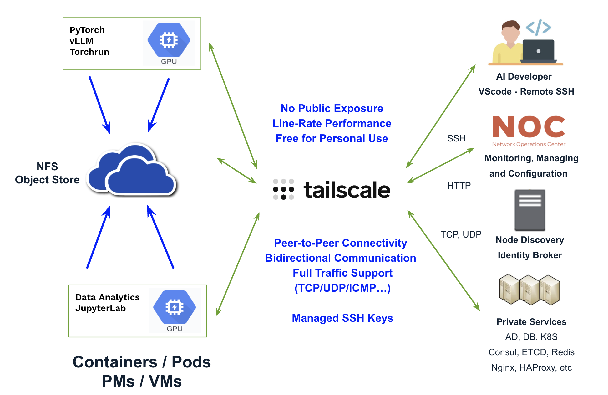
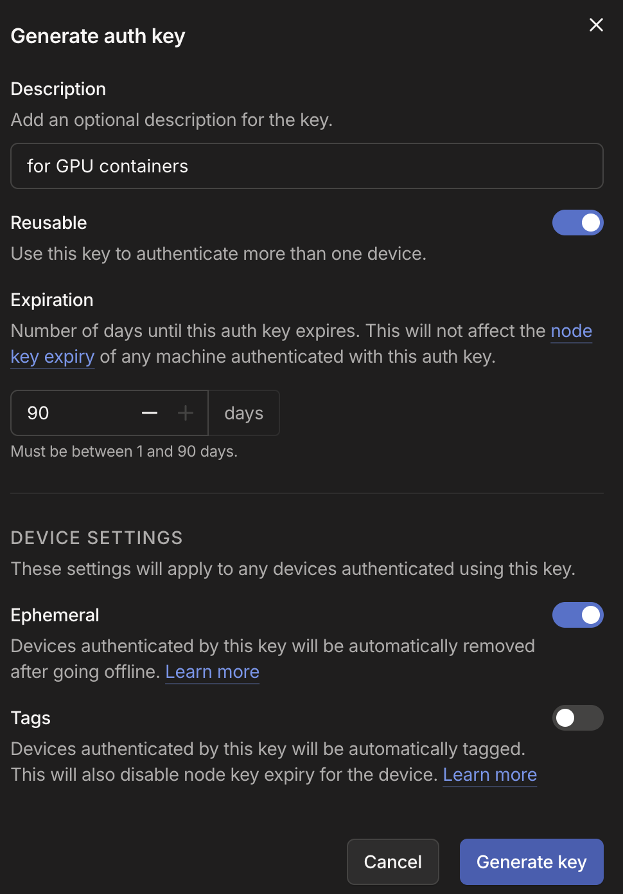

# Tailscale Integration - Remote Development

Suppose you have GPU-powered containers or PM/VMs running in the cloud and need to access them from your laptop for debugging, development, and monitoring without exposing them to the public internet. Tailscale provides a simple, secure, and high-performance way to do so.

It is free for personal use and offers full IP connectivity with near line-rate performance for direct peer-to-peer connections. In addition, Tailscale SSH uses identity-based authentication, eliminating the need to generate, distribute, and manage SSH keys.



## Documentation and Resources

- [Tailscale Solution Overview](https://docs.salad.com/container-engine/explanation/platform-integrations/tailscale-integration)

- [Add Tailscale Support into Workloads](https://docs.salad.com/container-engine/how-to-guides/platform-integrations/tailscale-basic)

- [Tailscale Plans](https://tailscale.com/pricing)

## Integration

### Step 1: Create a personal Tailscale account

### Step 2: Install and run Tailscale on a laptop

Follow [this guide](https://tailscale.com/docs/install/linux) to install Tailscale on the laptop - **ud25**:

``` bash
ubuntu@ud25:~$ curl -fsSL https://tailscale.com/install.sh | sh
```

Start the Tailscale client using web-based authentication:

<details>
<summary>laptop - ud25</summary>

``` bash
ubuntu@ud25:~$ sudo tailscale up
To authenticate, visit:
	https://login.tailscale.com/a/77544ca01a4a3
Success.

ubuntu@ud25:~$ tailscale version
1.98.10
  tailscale commit: 0ee734d3089846b27bc6ebcddd3d6ee5ec13e04d
  long version: 1.98.10-t0ee734d30-g6b4108809
  other commit: 6b4108809f6395c897bc1d4f5eb82ad882133989
  go version: go1.26.5 (tailscale/go 63ae404c82)

ubuntu@ud25:~$ tailscale ip
100.71.223.24
fd7a:115c:a1e0::a934:df19

ubuntu@ud25:~$ ifconfig | grep -A9 tailscale 
tailscale0: flags=4305<UP,POINTOPOINT,RUNNING,NOARP,MULTICAST>  mtu 1280
        inet 100.71.223.24  netmask 255.255.255.255  destination 100.71.223.24
        inet6 fd7a:115c:a1e0::a934:df19  prefixlen 128  scopeid 0x0<global>
        inet6 fe80::57d7:d233:c449:4c62  prefixlen 64  scopeid 0x20<link>
        unspec 00-00-00-00-00-00-00-00-00-00-00-00-00-00-00-00  txqueuelen 500  (UNSPEC)
        RX packets 511  bytes 41898 (41.8 KB)
        RX errors 0  dropped 0  overruns 0  frame 0
        TX packets 562  bytes 99007 (99.0 KB)
        TX errors 0  dropped 0 overruns 0  carrier 0  collisions 0

ubuntu@ud25:~$ tailscale status
100.71.223.24  ud25            richard.rshue@  linux    -                           
100.120.74.38  rs-dev-droplet  richard.rshue@  linux    -                           
100.90.105.69  win11           richard.rshue@  windows  -       

ubuntu@ud25:~$ tailscale ping 100.120.74.38
pong from rs-dev-droplet (100.120.74.38) via 134.199.197.247:41641 in 81ms

# SSH to a Tailscale machine
ubuntu@ud25:~$ tailscale ssh root@100.120.74.38 
root@rs-dev-droplet:~# 

# Enable SSH access from other devices in the same Tailscale tailnet.
ubuntu@ud25:~$ sudo tailscale set --ssh

ubuntu@ud25:~$ sudo tailscale set --ssh=false
ubuntu@ud25:~$ sudo tailscale set --ssh=true

# Valid for 180 days by default
ubuntu@ud25:~$ tailscale status --json | jq '.Self'
ubuntu@ud25:~$ tailscale status --json | jq '.Self.KeyExpiry'
"2027-01-28T23:21:52Z"

# After disable key expiry from the admin console
ubuntu@ud25:~$ tailscale status --json | jq '.Self.KeyExpiry'
null

ubuntu@ud25:~$ sudo tailscale down
ubuntu@ud25:~$ tailscale status
Tailscale is stopped.

ubuntu@ud25:~$ sudo tailscale up
ubuntu@ud25:~$ tailscale status
100.71.223.24  ud25            richard.rshue@  linux    -                           
100.120.74.38  rs-dev-droplet  richard.rshue@  linux    -                           
100.90.105.69  win11           richard.rshue@  windows  -     
```

</details>

### Step 3: Generate an authentication key for containers

Go to [the Tailscale admin console](https://console.tailscale.com/admin/settings/keys) and generate a reusable and ephemeral authentication key with a 90-day expiration period:




### Step 4: Add Tailscale support for Kubernetes pods.

Create a Kubernetes Secret named **rs-ts-auth-key**, and put the Tailscale authentication key inside it under the name **TS_AUTH_KEY**:

``` bash
kubectl create secret generic rs-ts-auth-key --from-literal=TS_AUTH_KEY=tskey-auth-**********-****

kubectl get secret
kubectl get secret rs-ts-auth-key -o jsonpath='{.data}' | jq
kubectl describe secret rs-ts-auth-key 
kubectl delete secret generic rs-ts-auth-key
```

Prepare the Kubernetes manifest ([dev-server.yaml](dev-server.yaml)):

<details>
<summary>dev-server.yaml</summary>

``` yaml
---
apiVersion: apps/v1
kind: StatefulSet
metadata:
  name: dev-server
spec:
  replicas: 1
  selector:
    matchLabels:
      app: dev-server
  template:
    metadata:
      labels:
        app: dev-server
    spec:
      # Restart the container automatically if it exits.
      restartPolicy: Always

      nodeSelector:
        doks.digitalocean.com/gpu-brand: amd

      tolerations:
        - key: amd.com/gpu
          operator: Exists
          effect: NoSchedule

      volumes:
        # Provide access to /dev/net/tun required by Tailscale WireGuard networking.
        - name: dev-net-tun
          hostPath:
            path: /dev/net/tun
            type: CharDevice

        - name: temp-hf-cache
          hostPath:
            path: /root/.cache/huggingface
            type: DirectoryOrCreate

        - name: dshm
          emptyDir:
            medium: Memory
            sizeLimit: 128Gi

      containers:
        - name: server
          #image: vllm/vllm-openai-rocm:v0.21.0
          image: rocm/pytorch:rocm7.0.2_ubuntu24.04_py3.12_pytorch_release_2.6.0 
          imagePullPolicy: Always
          
          command: ["/bin/bash", "-lc"]
          args:
            - |
              set -ex

              # Install Tailscale client inside the container.
              # Recommended: bake Tailscale into a custom image for production use.
              
              curl -fsSL https://tailscale.com/install.sh | sh

              # Start the Tailscale daemon.

              tailscaled &
              sleep 5

              # Register this pod as a Tailscale machine.
              # --auth-key: Authenticate using a pre-generated Tailscale auth key stored in Kubernetes Secret.
              # --hostname: Use the StatefulSet pod name (for example dev-server-0) as the Tailscale machine name.
              # --accept-dns=false: Prevent Tailscale from modifying DNS resolution settings, avoiding conflicts with Kubernetes CoreDNS.

              tailscale up --auth-key=${TS_AUTH_KEY} --hostname=$(hostname)
              sleep 5

              tailscale set --ssh

              # Export environment variables for interactive sessions.
              printenv > /etc/environment

              mkdir /root/work
              cd /root/work
          
              exec sleep infinity
              # Do some work here, e.g., run a server or training script.

          env:
            # Inject the Tailscale auth key from Kubernetes Secret.
            - name: TS_AUTH_KEY
              valueFrom:
                secretKeyRef:           
                  name: rs-ts-auth-key
                  key: TS_AUTH_KEY

          securityContext:
            capabilities:
              add:
                - IPC_LOCK    # Allow memory locking (commonly needed by RDMA/GPU workloads).
                - NET_ADMIN   # Required by Tailscale for network configuration.

          volumeMounts:

            - name: temp-hf-cache
              mountPath: /root/.cache/huggingface

            - name: dshm
              mountPath: /dev/shm

            - name: dev-net-tun
              mountPath: /dev/net/tun

          resources:
            limits:
              amd.com/gpu: "8"
            requests:
              amd.com/gpu: "8"
```

</details>

### Step 5: Deploy a pod and access it from the laptop

Deploy a pod using the Kubernetes manifest:

``` bash
# kubectl apply -f dev-server.yaml

# kubectl delete -f dev-server.yaml

# kubectl get pods -o wide
NAME           READY   STATUS    RESTARTS   AGE   IP            NODE                        NOMINATED NODE   READINESS GATES
dev-server-0   1/1     Running   0          70m   10.135.1.82   rs-mn-mi355x8-pool-3708jg   <none>           <none>

# kubectl get nodes -o wide
NAME                        STATUS   ROLES    AGE    VERSION   INTERNAL-IP   EXTERNAL-IP      OS-IMAGE                       KERNEL-VERSION                CONTAINER-RUNTIME
rs-cpu-pool-37i198          Ready    <none>   3d5h   v1.36.0   10.134.0.3    168.144.58.174   Debian GNU/Linux 13 (trixie)   6.12.95+deb13-amd64 (amd64)   containerd://2.2.3
rs-mn-mi355x8-pool-3708jg   Ready    <none>   37h    v1.36.0   10.134.0.5    168.144.61.118   Debian GNU/Linux 13 (trixie)   6.12.95+deb13-amd64 (amd64)   containerd://2.2.3
rs-mn-mi355x8-pool-37i19u   Ready    <none>   3d5h   v1.36.0   10.134.0.4    168.144.58.88    Debian GNU/Linux 13 (trixie)   6.12.95+deb13-amd64 (amd64)   containerd://2.2.3
```

Access it from the laptop - **ud25**:

``` bash
ubuntu@ud25:~$ tailscale status
100.71.223.24   ud25            richard.rshue@  linux    -                                                         
100.112.180.67  dev-server-0    richard.rshue@  linux    active; direct 168.144.61.118:46191, tx 113224 rx 151240  
100.120.74.38   rs-dev-droplet  richard.rshue@  linux    -                                                         
100.90.105.69   win11           richard.rshue@  windows  -                                                         

ubuntu@ud25:~$ tailscale ping 100.112.180.67
pong from dev-server-0 (100.112.180.67) via 168.144.61.118:46191 in 90ms

ubuntu@ud25:~$ tailscale ssh root@100.112.180.67
Welcome to Ubuntu 24.04.3 LTS (GNU/Linux 6.12.95+deb13-amd64 x86_64)
 * Documentation:  https://help.ubuntu.com
 * Management:     https://landscape.canonical.com
 * Support:        https://ubuntu.com/pro
This system has been minimized by removing packages and content that are
not required on a system that users do not log into.
To restore this content, you can run the 'unminimize' command.

root@dev-server-0:~# tailscale ip
100.112.180.67
fd7a:115c:a1e0::bf34:b444

root@dev-server-0:~# ip -br a
lo               UNKNOWN        127.0.0.1/8 ::1/128 
tailscale0       UNKNOWN        100.112.180.67/32 fd7a:115c:a1e0::bf34:b444/128 fe80::e281:5556:52f3:594d/64 
eth0@if59        UP             10.135.1.82/32 fe80::a4ea:e5ff:fe72:b3f1/64 

root@dev-server-0:~# rocm-smi
============================================ ROCm System Management Interface ============================================
====================================================== Concise Info ======================================================
Device  Node  IDs              Temp        Power     Partitions          SCLK   MCLK     Fan  Perf  PwrCap   VRAM%  GPU%  
              (DID,     GUID)  (Junction)  (Socket)  (Mem, Compute, ID)                                                   
==========================================================================================================================
0       2     0x75b3,   1966   55.0°C      283.0W    NPS1, SPX, 0        38Mhz  2000Mhz  0%   auto  1400.0W  0%     11%   
1       3     0x75b3,   49577  56.0°C      272.0W    NPS1, SPX, 0        38Mhz  2000Mhz  0%   auto  1400.0W  0%     11%   
2       4     0x75b3,   52131  58.0°C      277.0W    NPS1, SPX, 0        38Mhz  2000Mhz  0%   auto  1400.0W  0%     8%    
3       5     0x75b3,   3492   59.0°C      268.0W    NPS1, SPX, 0        38Mhz  2000Mhz  0%   auto  1400.0W  0%     9%    
4       6     0x75b3,   57271  53.0°C      263.0W    NPS1, SPX, 0        38Mhz  2000Mhz  0%   auto  1400.0W  0%     5%    
5       7     0x75b3,   6576   58.0°C      259.0W    NPS1, SPX, 0        38Mhz  2000Mhz  0%   auto  1400.0W  0%     0%    
6       8     0x75b3,   5050   51.0°C      254.0W    NPS1, SPX, 0        38Mhz  2000Mhz  0%   auto  1400.0W  0%     0%    
7       9     0x75b3,   54717  64.0°C      271.0W    NPS1, SPX, 0        38Mhz  2000Mhz  0%   auto  1400.0W  0%     2%    
==========================================================================================================================
================================================== End of ROCm SMI Log ===================================================

root@dev-server-0:~# 
```